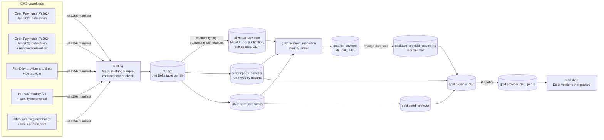

# provider-360-lakehouse

**A Delta Lake pipeline that joins three federal healthcare datasets, which use different provider IDs, into
one row per provider. Inputs: Open Payments (drug and device company payments to clinicians, two
publications), Medicare Part D prescribing, and the NPPES provider registry, <!--n:rows_landed-->73,345,661<!--/n--> source rows
in total. CMS republishes Open Payments every six months, and each republication is applied with a single
guarded MERGE. The result matches CMS's own published totals: <!--n:r1_our_records-->15,498,687<!--/n--> live payment
records against CMS's <!--n:r1_cms_records-->15,498,687<!--/n-->, and a dollar difference of $<!--n:r1_usd_diff-->0.00<!--/n-->. Gold tables
are published only after all <!--n:run_2_june_checks-->9<!--/n--> blocking Dagster checks pass.**

`Python` · `PySpark` · `Delta Lake` · `Dagster` · `pyarrow` · `SQL` · `GitHub Actions`

| Business problem | What I built | Measured result |
|---|---|---|
| The same clinician has a different ID in each system. Payments carry an NPI typed in by the paying company, and that NPI is sometimes missing or wrong. | A deterministic identity ladder: record NPI (check digit + registry), CMS profile map, unique name + ZIP5. When more than one candidate matches, it abstains. A name + state rung was tried and switched off because its dev-split precision was <!--n:er_name_state_dev_precision_pct-->97.00<!--/n-->%, below the 99% bar (`rung_selection` in `results/identity.json`). The ladder is evaluated on an NPI-disjoint holdout with the NPI hidden. | Holdout test set (<!--n:er_test_entities-->295,832<!--/n--> recipients): precision <!--n:er_precision_pct-->99.63<!--/n-->% (95% CI lower bound <!--n:er_precision_ci_low_pct-->99.60<!--/n-->%), recall <!--n:er_recall_pct-->58.62<!--/n-->%, abstained <!--n:er_abstain_pct-->0.33<!--/n-->%. <!--n:er_payments_rescued-->2,232<!--/n--> payments without a usable NPI were linked by name + ZIP. The ladder prefers abstaining to guessing, so recall on the hidden-NPI test is modest. |
| The source is republished every six months: records are added, corrected, disputed, or withdrawn. A truncated file must not delete half the table. | One MERGE per publication, driven by a content hash, with soft deletes, an ordering guard, a truncation guard, and the change data feed turned on. The gold aggregate reads only the changes. | January to June 2026: <!--n:june_inserted-->273,413<!--/n--> inserted, <!--n:june_changed-->151,161<!--/n--> changed, <!--n:june_soft_deleted-->159,773<!--/n--> soft-deleted. Our classification agrees with CMS's own `Change_Type` labels and deletion list on <!--n:restatement_agree_pct-->100.0<!--/n-->% of <!--n:restatement_records-->15,658,870<!--/n--> records. <!--n:restatement_never_in_table-->410<!--/n--> ids on CMS's removed list were never in the January file, so there was nothing to delete. Re-applying a publication changed <!--n:reapply_changed_rows-->0<!--/n--> rows. The incremental aggregate equals a full recompute, row for row. |
| Numbers you can't check against an outside source can't be trusted. | Referees built from CMS's own published totals, plus data contracts that quarantine bad rows, and a PII policy enforced on the public table. | Per-recipient totals match CMS exactly for <!--n:r2_exact_pct-->99.069<!--/n-->% of <!--n:r2_recipients-->994,914<!--/n--> recipients (<!--n:r2_exact_usd_pct-->99.82<!--/n-->% of the dollars). Part D: the by-drug file accounts for <!--n:r3_claims_coverage_pct-->86.5<!--/n-->% of the claims in CMS's by-provider file. CMS suppresses drug rows with fewer than 11 claims, so no NPI may come out higher than CMS's total; <!--n:r3_unexplained-->0<!--/n--> of <!--n:r3_npis-->1,416,883<!--/n--> NPIs did. |

Everyday equivalent: this is the **customer-360 / master-data** problem that most companies have. CRM, billing
and support each use their own customer ID, vendors resend whole files with corrections, and the merged
table has to reconcile with the system of record before anyone uses it.

---

## Architecture



Every box after landing is a Dagster asset. Blocking asset checks guard the silver and gold tables:
quarantine budgets for every source, primary keys, R1 CMS totals, R3 Part D totals, incremental == full, and no
direct PII in the public table. The `published` asset runs only when all of these pass. It records which Delta
version of each gold table consumers should read (write-audit-publish with Delta time travel).

Some measurements are taken after the run and do not gate it: R2 (per-recipient totals), the restatement
cross-tab, and the identity holdout. A correct national total does not prove that each payment is attributed to
the right provider; R2 and the holdout are the evidence for attribution.

## Data

| Source | Rows landed | Link |
|---|---|---|
| Open Payments general payments, PY2024, January 2026 publication | <!--n:rows_op_payment_p2026_01-->15,385,047<!--/n--> | [openpaymentsdata.cms.gov](https://openpaymentsdata.cms.gov/) |
| Open Payments general payments, PY2024, June 2026 publication | <!--n:rows_op_payment_p2026_06-->15,498,687<!--/n--> | same |
| Open Payments removed/deleted records (June 2026) | <!--n:rows_op_removed_p2026_06-->160,183<!--/n--> | same |
| Open Payments covered recipient profile supplement | <!--n:rows_op_profile_supplement-->1,697,025<!--/n--> | same |
| CMS totals per covered recipient x nature of payment (referee) | <!--n:rows_op_recipient_nature_summary-->1,241,266<!--/n--> | same |
| Medicare Part D prescribers by provider and drug, 2024 | <!--n:rows_partd_prescriber_drug-->28,023,892<!--/n--> | [data.cms.gov](https://data.cms.gov/provider-summary-by-type-of-service/medicare-part-d-prescribers) |
| Medicare Part D prescribers by provider, 2024 (referee) | <!--n:rows_partd_prescriber-->1,416,883<!--/n--> | same |
| NPPES NPI registry, November 2026 full file | <!--n:rows_nppes_full-->9,891,116<!--/n--> | [download.cms.gov/nppes](https://download.cms.gov/nppes/NPI_Files.html) |
| NPPES weekly incremental, 2026-11-02 to 11-08 | <!--n:rows_nppes_weekly_2026_11_08-->31,562<!--/n--> | same |

All files are U.S. federal public data published by CMS. The exact URLs are pinned in `sources.yaml`, and
`data/raw/_manifest.jsonl` records bytes, sha256 and Last-Modified for each one
(<!--n:raw_gb-->8.4<!--/n--> GB downloaded). Raw and lake data are not committed. `fixtures/raw/` is a small **real** slice of
every file (providers practising in Chicago ZIPs 60637 and 60615), kept in the original layout.

## Run it

```bash
make init        # uv sync --locked (needs JDK 17 for Spark)
make check       # lint + unit + end-to-end on the real fixture (two Dagster runs, all checks) + README numbers
make demo        # same pipeline on the fixture into .demo/; `make ui` opens the Dagster asset graph
make reproduce   # full data: download (~8 GB), land, two runs (January, then June), experiments, report
```

## Results (full data, laptop: Apple M-series, 16 GB RAM, Spark local[4], 5 GB driver)

| What | Result | File |
|---|---|---|
| Pipeline run 1 (as of the January publication) | <!--n:run_1_january_minutes-->15.3<!--/n--> min, <!--n:run_1_january_checks_passed-->9<!--/n-->/<!--n:run_1_january_checks-->9<!--/n--> checks passed | `results/run_1_january.json` |
| Pipeline run 2 (apply the June publication incrementally) | <!--n:run_2_june_minutes-->11.8<!--/n--> min, <!--n:run_2_june_checks_passed-->9<!--/n-->/<!--n:run_2_june_checks-->9<!--/n--> checks passed | `results/run_2_june.json` |
| R1: live PY2024 general payments vs CMS dashboard | <!--n:r1_our_records-->15,498,687<!--/n--> vs <!--n:r1_cms_records-->15,498,687<!--/n--> records; USD <!--n:r1_cms_usd-->3,424,344,413.22<!--/n--> on the CMS side, our difference $<!--n:r1_usd_diff-->0.00<!--/n--> | `results/r1_open_payments_totals.json` |
| R2: per-recipient totals vs CMS grouped file | <!--n:r2_exact_pct-->99.069<!--/n-->% of <!--n:r2_recipients-->994,914<!--/n--> recipients exact (<!--n:r2_exact_usd_pct-->99.82<!--/n-->% of dollars); the rest are not yet explained | `results/r2_recipient_totals.json` |
| R3: Part D by-drug vs by-provider claims | <!--n:r3_npis-->1,416,883<!--/n--> NPIs: <!--n:r3_exact_pct-->0.293<!--/n-->% exact, <!--n:r3_lower_npis-->1,135,305<!--/n--> lower (suppressed drug rows), <!--n:r3_no_drug_rows_npis-->277,428<!--/n--> with every drug row suppressed, <!--n:r3_unexplained-->0<!--/n--> higher or unmatched; <!--n:r3_claims_coverage_pct-->86.5<!--/n-->% of claims covered | `results/r3_partd_by_provider.json` |
| Restatement vs CMS `Change_Type` | <!--n:restatement_agree_pct-->100.0<!--/n-->% agreement (full cross-tab in the file) | `results/restatement.json` |
| Re-apply latest publication + weekly file | <!--n:reapply_changed_rows-->0<!--/n--> rows changed | `results/idempotency.json` |
| Identity holdout (test split) | precision <!--n:er_precision_pct-->99.63<!--/n-->%, recall <!--n:er_recall_pct-->58.62<!--/n-->%, abstained <!--n:er_abstain_pct-->0.33<!--/n-->% | `results/identity.json` |
| Gold aggregate: change-feed incremental vs full recompute | identical rows; <!--n:agg_incremental_s-->6.8<!--/n--> s (<!--n:agg_npis_recomputed-->90,674<!--/n--> NPIs recomputed) vs <!--n:agg_full_s-->7.5<!--/n--> s for <!--n:agg_rows-->984,802<!--/n--> NPIs. At this size the saving is small; the point is correctness under replay | `results/performance.json` |
| `OPTIMIZE ... ZORDER BY resolved_npi` (32 MB files, on a scratch copy), one-provider lookup | files read <!--n:zorder_files_before-->64<!--/n--> of <!--n:zorder_table_files_before-->64<!--/n--> -> <!--n:zorder_files_after-->1<!--/n--> of <!--n:zorder_table_files_after-->25<!--/n-->; rows scanned <!--n:zorder_rows_scanned_before-->15,461,299<!--/n--> -> <!--n:zorder_rows_scanned_after-->670,758<!--/n--> | `results/performance.json` |
| Join payments x registry: sort-merge vs broadcast | <!--n:join_smj_s-->4.1<!--/n--> s vs <!--n:join_bcast_s-->3.0<!--/n--> s (one run each, laptop) | `results/performance.json` |
| provider_360 | <!--n:p360_providers-->1,663,748<!--/n--> providers, <!--n:p360_both-->737,937<!--/n--> with both payments and Part D claims, <!--n:p360_deactivated-->8,945<!--/n--> deactivated in the registry | `results/provider_360.json` |

All numbers above are rendered from `results/*.json` by `p360 report`, and `tests/test_readme_numbers.py` fails if
they drift. `docs/dashboard.html` shows the same results, including the restatement cross-tab.

## Design notes

- [docs/decisions/](docs/decisions/): Delta + MERGE, Dagster + blocking checks, the identity ladder, landing format
- [docs/INCIDENTS.md](docs/INCIDENTS.md): six real problems hit on the full data (Spark sort before a partitioned write, an
  expensive row hash, Delta column names, year-0002 dates, a referee key collision, an imprecise matching rule)
- [docs/RUNBOOK.md](docs/RUNBOOK.md): schedules, what each check failure means, recovery
- [docs/LINEAGE.md](docs/LINEAGE.md): column lineage of `provider_360` and which columns the PII policy removes

## Limitations and what differs from production

- **Local only.** Spark runs in local mode and the Delta tables sit on the local disk. The code is plain PySpark +
  open-source Delta. Moving to Databricks or another Spark platform needs object storage paths, a catalog (Unity
  Catalog / Glue) and a scheduler. **None of that has been deployed or tested in the cloud.**
- **Governance is a mechanism, not access control.** The contract tags PII, and the public table drops columns
  derived from direct PII. Real deployments enforce access in the catalog. NPI is a public identifier and stays.
- **Identity resolution is deterministic.** It favours precision and abstains when unsure. The holdout "truth" is
  the NPI the paying company reported. That NPI is check-digit valid and present in the registry, but it is not
  independently verified to be the right person. Recall on records without a usable NPI is limited (see
  `results/identity.json`). A probabilistic matcher would be the next step.
- **Part D detail is partial by design.** CMS suppresses drug rows with fewer than 11 claims. `provider_360`
  therefore carries CMS's own per-provider totals (`partd_total_claims`) next to the observed drug-row subtotal
  (`partd_drug_row_claims`).
- **Two publications only.** CMS does not keep older publications of PY2024 online, so the restatement logic has
  been exercised on one real transition (January to June 2026). NPPES has one weekly file applied.
- **Registry attributes are current, not as of 2024.** NPPES is a November 2026 snapshot, so a provider's 2024
  location may differ.
